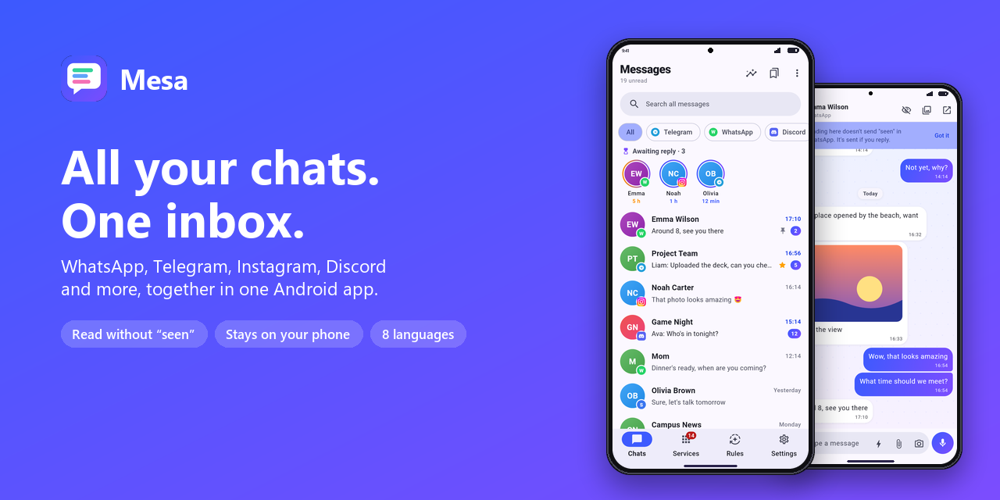
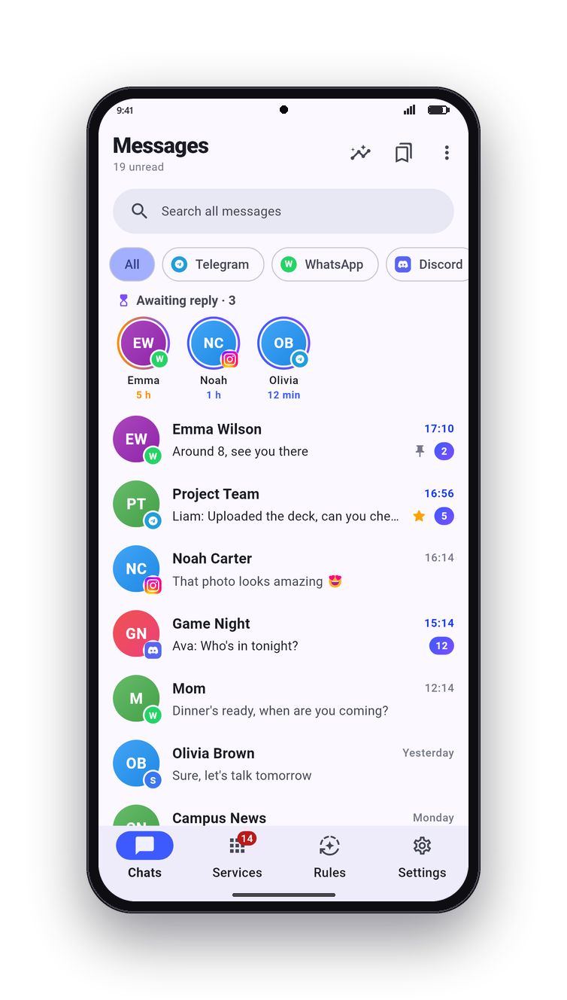
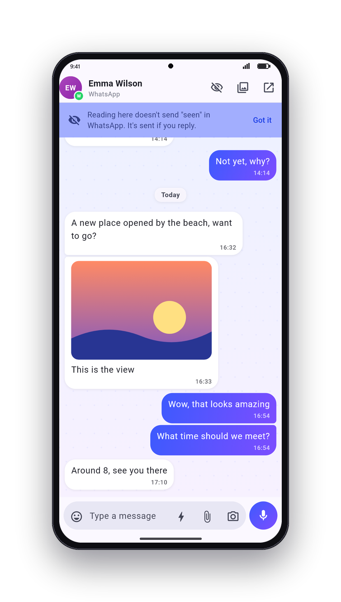
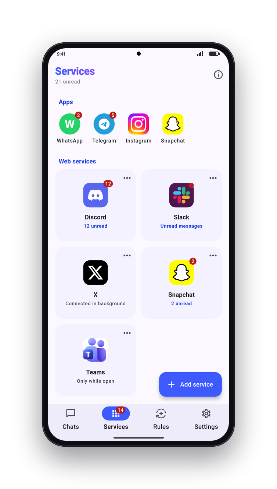
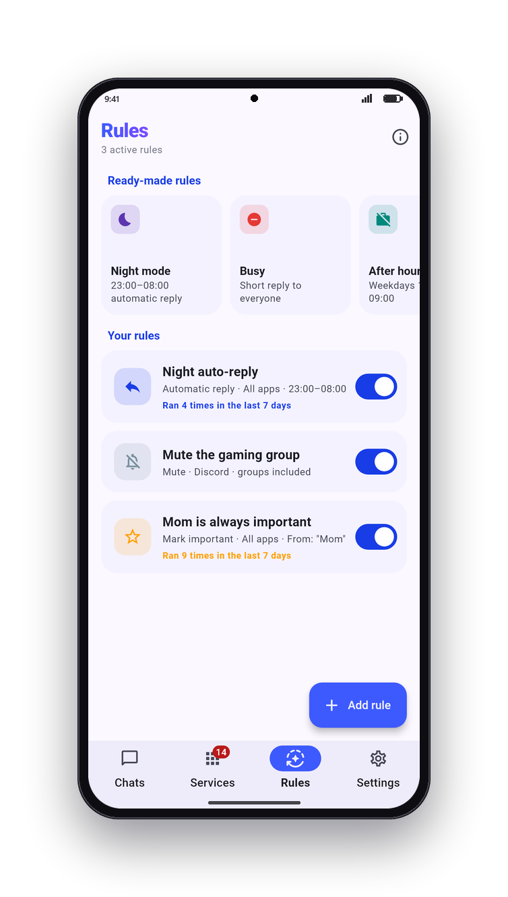
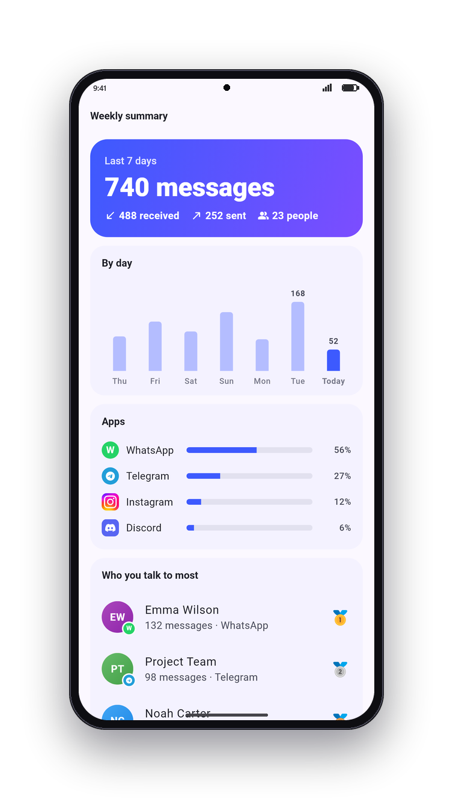
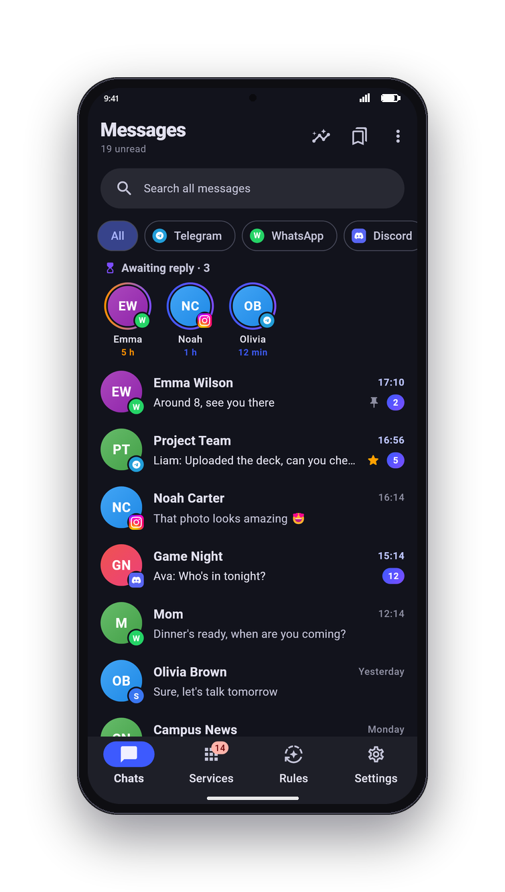
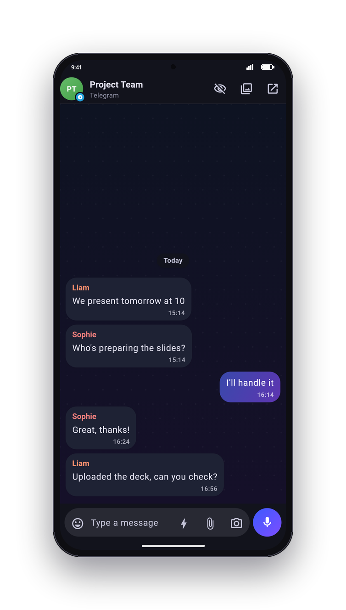
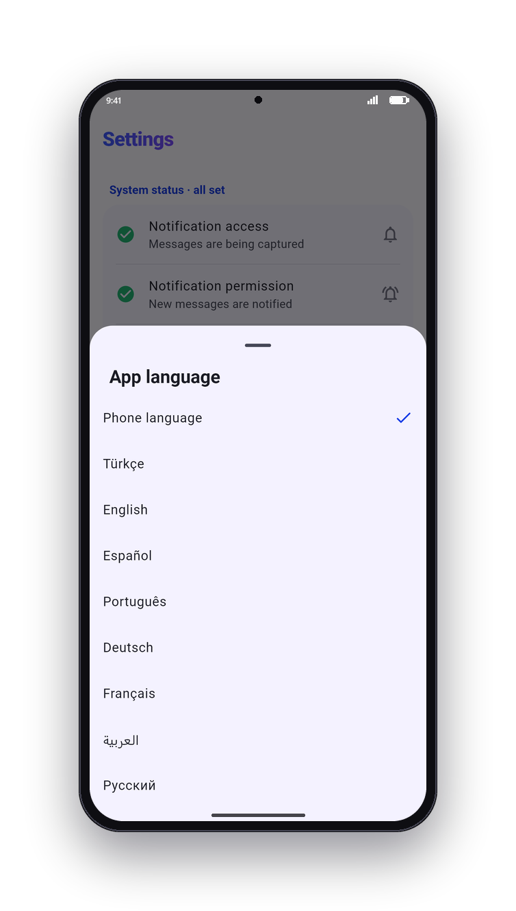
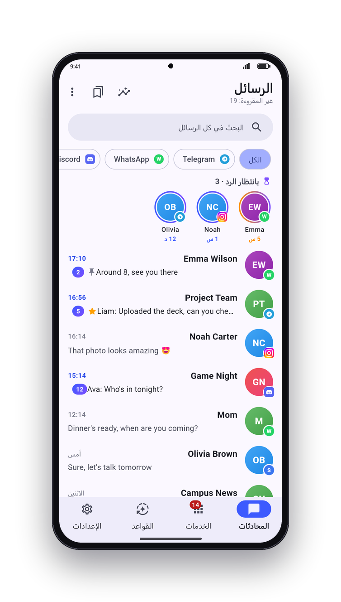

# Mesa

<p align="center">
  
</p>

**All your chats. One inbox.** WhatsApp, Telegram, Instagram, Discord and more, together in one Android app. Mesa has no servers and no account: your messages stay on your phone.

## Download

Get the APK from [Releases](https://github.com/lemuxon/mesa/releases/latest) (Android 7.0 or later). Most phones need `arm64-v8a`; older 32-bit phones need `armeabi-v7a`.

**Android 13 and later:** Android restricts notification access for apps installed from outside an app store. If Mesa's switch is greyed out ("Restricted setting"), tap it once, then open **Settings → Apps → Mesa → ⋮ → Allow restricted settings** and turn it on again. Mesa shows these steps on its first screen too.

v1.0.0 was signed with this certificate (SHA-256):
`31:74:AB:2A:5A:56:77:BD:53:4C:CB:65:FA:1C:26:BE:28:91:FC:C1:9A:1C:C6:67:30:ED:A4:51:BD:82:70:27`

**From v1.0.1 on, releases are signed with a new certificate** (SHA-256):
`6E:38:FB:B0:35:73:C8:60:9D:C4:DF:B2:C6:31:47:37:68:5A:49:45:7D:9C:FD:CC:BD:64:CF:5F:D6:58:F2:5F`

Check a downloaded APK with `apksigner verify --print-certs Mesa.apk` (Android SDK build-tools). Android cannot update 1.0.0 to 1.0.1 in place: back up from Settings → Backup, uninstall, install the new APK, restore. See [CHANGELOG](CHANGELOG.md).

## Features

- **One inbox** for WhatsApp, WhatsApp Business, Telegram, Instagram, Messenger, Signal, Viber, LINE, KakaoTalk, SMS and more, plus Discord, Slack, X, Teams, LinkedIn, Reddit, Snapchat and TikTok through their official web versions.
- **One person, one conversation.** Merge the same person's chats from different apps into a single timeline and reply from whichever app you like.
- **Read without sending "seen".** Opening a WhatsApp or Instagram message in Mesa sends no read receipt until you reply. Optional ghost mode for Telegram.
- **Reply from the notification** with unified notifications and one-tap quick replies.
- **Deleted messages keep their text.** If the sender deletes a message, what they wrote stays in Mesa, labeled "deleted".
- **Stay on top:** people waiting for your reply come first; snooze chats, schedule messages, save important messages and search across every app.
- **Rules:** automatic replies (with safety limits), mute, mark important; they run even when the app is closed.
- **Weekly summary**, **home screen widget**, **app lock** (fingerprint, face or screen lock).
- **Encrypted backups** with your own password (AES-256-GCM).
- **Secure connection:** secure DNS (DNS over HTTPS) for the whole phone with Cloudflare 1.1.1.1, AdGuard (blocks ads and trackers), Quad9 or Google, plus a quick settings tile; an access shield that lets Mesa's web services through DNS and SNI blocks without a VPN; Telegram proxies (MTProto / SOCKS5); and a **full VPN** with your own WireGuard configuration.
- **Focus mode:** only VIPs, important messages and emergencies get through, on demand or on a schedule, with a summary afterwards and a quick settings tile.
- **Automatic encrypted backups** to a folder you choose, and **chat bubbles** for replying without opening the app.
- **Your WhatsApp replies in Mesa too** (optional): what you send inside WhatsApp joins the same chat in Mesa.
- **8 languages:** English, Spanish, Portuguese, German, French, Turkish, Russian and Arabic, with right-to-left support.

## Screenshots

<p align="center">
  
  
  
  
  
</p>
<p align="center">
  
  
  
  
</p>

All people and messages in the screenshots are fictional.

## How it works

- **Apps on your phone:** Mesa reads incoming messages from Android notifications (notification access) and replies through the notification's own reply action. No unofficial APIs, no extra login.
- **Telegram:** connects directly with Telegram's official library (TDLib), so muted groups and chat history arrive too.
- **Web services:** each service opens its official website in a built-in browser, with separate sessions per account.

**Limitations.** For notification-based apps, Mesa only sees messages that arrive as notifications after it's installed (no older history), and messages you type directly inside another app don't appear in Mesa, except WhatsApp replies when the optional accessibility service is on. Android only.

## Privacy

- No Mesa servers, no analytics, no ads, no account.
- Messages are stored only on your phone and are excluded from cloud backups and device-to-device transfer.
- Backups are files you create and keep, encrypted with your password.
- Secure DNS and the access shield are off until you turn them on. Then DNS lookups go, encrypted, to the DNS provider you pick (Cloudflare, AdGuard, Quad9 or Google), not to your carrier. Secure DNS is not a full VPN: it does not hide your IP address.
- The optional "Mesa: my WhatsApp replies" accessibility service only receives WhatsApp and WhatsApp Business screens, reads just the message box, the Send button and the chat name, and adds what you send to chats already in Mesa. Message text is never logged.
- The WireGuard VPN connects only to the server in the configuration you import; Mesa provides no VPN server. That configuration and the automatic backup password are stored encrypted with a key that never leaves the phone's Android Keystore.

## Build

Requirements: Flutter 3.50 or later (stable), Android SDK (platform 36, NDK 28.2), JDK 21. Gradle downloads itself through the wrapper.

TDLib is not stored in the repository. Download the build made from Telegram's official source by the [TDLib Android workflow](.github/workflows/tdlib-android.yml) (the script verifies its SHA256):

```bash
scripts/tdlib_indir.sh
flutter build apk --release --split-per-abi
```

On Windows, use the PowerShell version of the TDLib script (no Git Bash needed):

```powershell
powershell -ExecutionPolicy Bypass -File scripts\tdlib_indir.ps1
flutter build apk --release --split-per-abi
```

Keep the project in a path with only ASCII characters and outside OneDrive or other sync folders (for example `C:\dev\mesa`). The Android Gradle plugin rejects non-ASCII paths on Windows, and sync clients lock or drop build files.

Telegram needs your own API credentials from [my.telegram.org](https://my.telegram.org) → "API development tools". Add them to `android/local.properties` (not committed):

```properties
telegram.apiId=123456
telegram.apiHash=your_api_hash
```

**Back up the files that are not in git.** Without them a fresh clone still builds, but release updates and Telegram stop working: the release keystore and `android/key.properties` (losing them is why 1.0.1 needs a reinstall), and `android/local.properties` (Telegram credentials). Store copies in a password manager or an encrypted drive, not in the repository.

Tests:

```bash
flutter test
cd android && ./gradlew :app:testDebugUnitTest
```

Both also run in GitHub Actions on every push ([CI workflow](.github/workflows/ci.yml)). On Windows with Smart App Control turned on, `flutter test` cannot start the unsigned `flutter_tester.exe`; rely on CI for the Dart tests there.

Promo images: `flutter test test_screens/promo_test.dart`, then `python tool/branding/make_promo.py`. Icons: `python tool/branding/make_icons.py`.

## License

Mesa is released under the [MIT License](LICENSE).

Telegram support uses [TDLib](https://github.com/tdlib/td) (Boost Software License 1.0). Service icons in `assets/web_icons` are trademarks of their respective owners and are used only to identify those services.

## Disclaimer

Mesa is an independent project. It is not affiliated with, endorsed by or sponsored by WhatsApp, Meta, Telegram, Signal, Discord, Slack, X, Microsoft or any other service it works with. All product names and trademarks belong to their respective owners.
