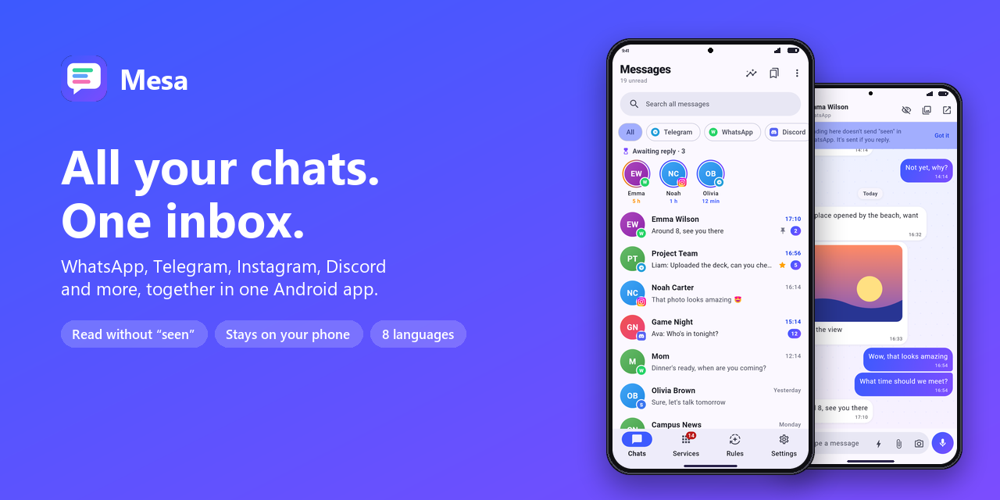
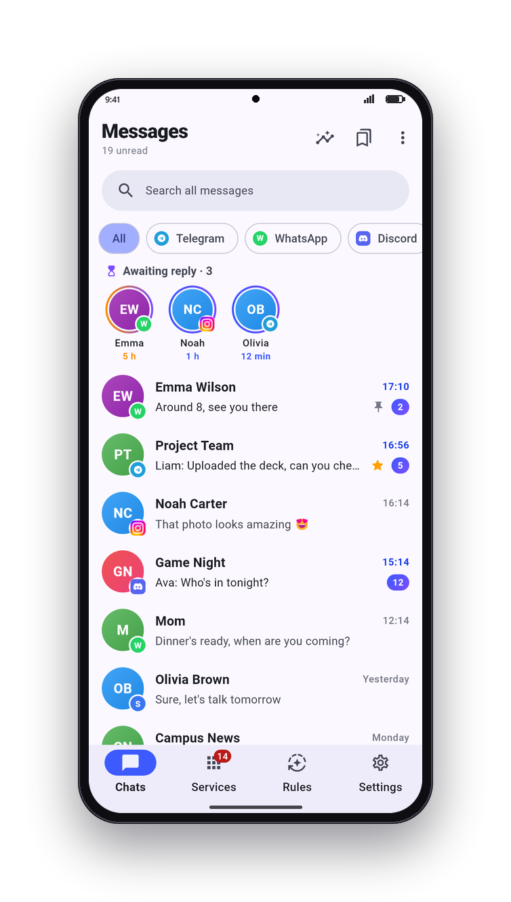
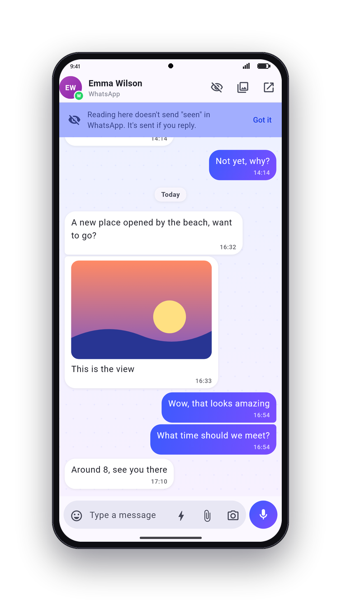
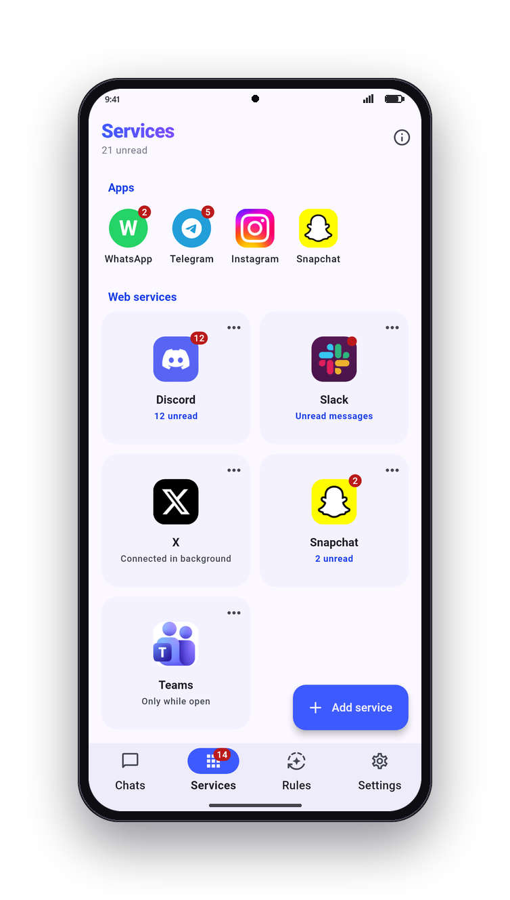
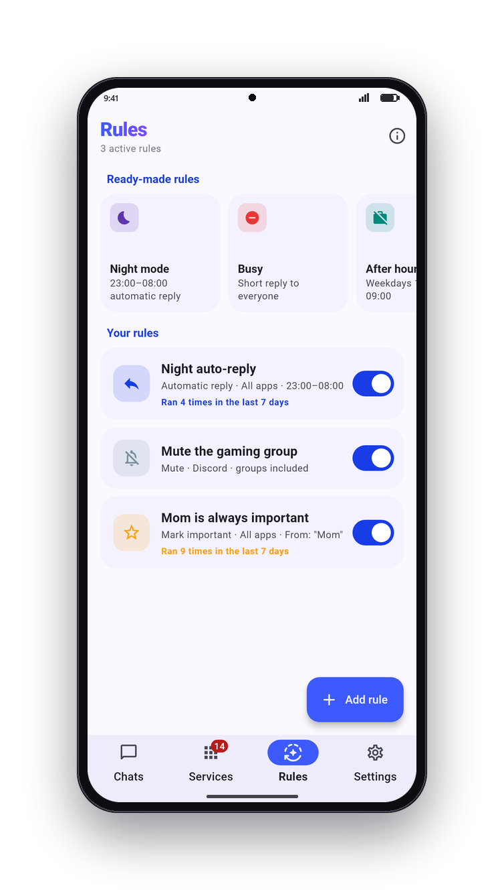
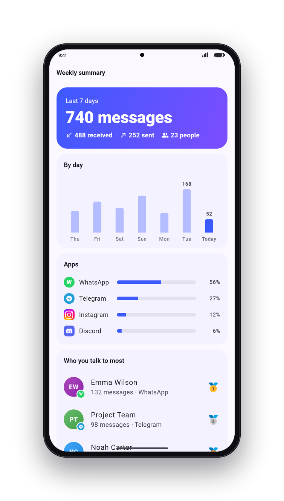
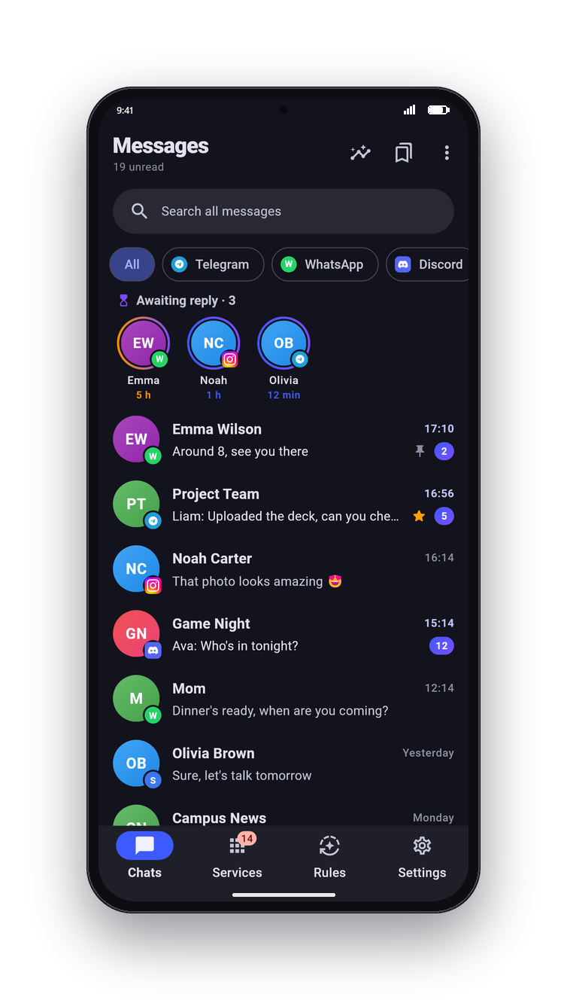
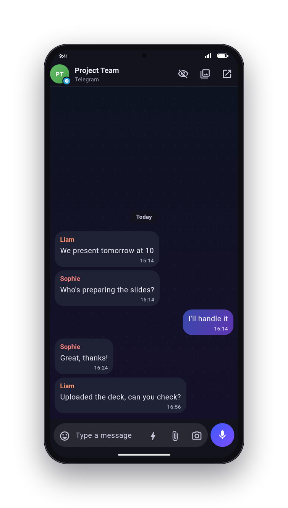
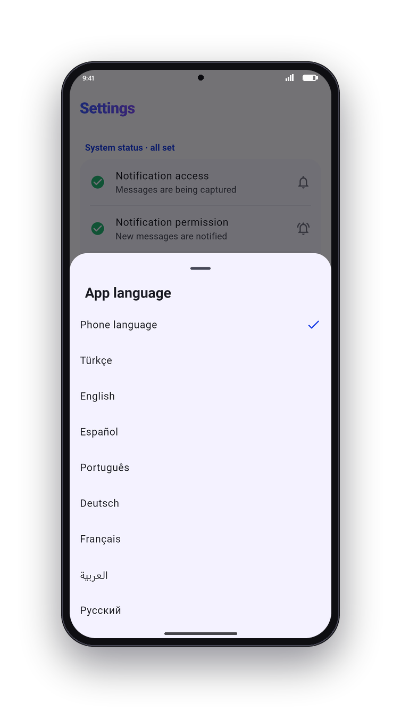
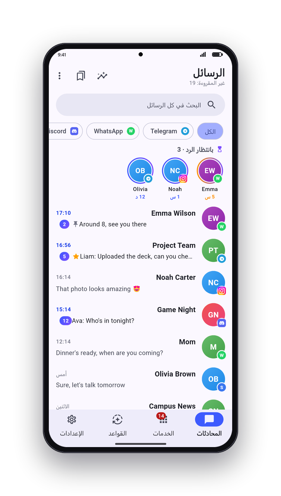

# Mesa

<p align="center">
  
</p>

**All your chats. One inbox.** WhatsApp, Telegram, Instagram, Discord and more, together in one Android app. Mesa has no servers and no account: your messages stay on your phone.

## Features

- **One inbox** for WhatsApp, WhatsApp Business, Telegram, Instagram, Messenger, Signal, Viber, LINE, KakaoTalk, SMS and more, plus Discord, Slack, X, Teams, LinkedIn, Reddit, Snapchat and TikTok through their official web versions.
- **One person, one conversation.** Merge the same person's chats from different apps into a single timeline and reply from whichever app you like.
- **Read without sending "seen".** Opening a WhatsApp or Instagram message in Mesa sends no read receipt until you reply. Optional ghost mode for Telegram.
- **Reply from the notification** with unified notifications and one-tap quick replies.
- **Deleted messages keep their text.** If the sender deletes a message, what they wrote stays in Mesa, labeled "deleted".
- **Stay on top:** people waiting for your reply come first; snooze chats, schedule messages, save important messages and search across every app.
- **Rules:** automatic replies (with safety limits), mute, mark important; they run even when the app is closed.
- **Weekly summary**, **home screen widget**, **app lock** (fingerprint, face or screen lock).
- **Encrypted backups** with your own password (AES-256-GCM).
- **8 languages:** English, Spanish, Portuguese, German, French, Turkish, Russian and Arabic, with right-to-left support.

## Screenshots

<p align="center">
  
  
  
  
  
</p>
<p align="center">
  
  
  
  
</p>

All people and messages in the screenshots are fictional.

## How it works

- **Apps on your phone:** Mesa reads incoming messages from Android notifications (notification access) and replies through the notification's own reply action. No unofficial APIs, no extra login.
- **Telegram:** connects directly with Telegram's official library (TDLib), so muted groups and chat history arrive too.
- **Web services:** each service opens its official website in a built-in browser, with separate sessions per account.

**Limitations.** For notification-based apps, Mesa only sees messages that arrive as notifications after it's installed (no older history), and messages you type directly inside another app don't appear in Mesa. Android only.

## Privacy

- No Mesa servers, no analytics, no ads, no account.
- Messages are stored only on your phone and are excluded from cloud backups and device-to-device transfer.
- Backups are files you create and keep, encrypted with your password.

## Build

Requirements: Flutter (stable), Android SDK, JDK 21.

TDLib is not stored in the repository. Download the build made from Telegram's official source by the [TDLib Android workflow](.github/workflows/tdlib-android.yml) (the script verifies its SHA256):

```bash
scripts/tdlib_indir.sh
flutter build apk --release --split-per-abi
```

Telegram needs your own API credentials from [my.telegram.org](https://my.telegram.org) → "API development tools". Add them to `android/local.properties` (not committed):

```properties
telegram.apiId=123456
telegram.apiHash=your_api_hash
```

Tests:

```bash
flutter test
cd android && ./gradlew :app:testDebugUnitTest
```

Promo images: `flutter test test_screens/promo_test.dart`, then `python tool/branding/make_promo.py`. Icons: `python tool/branding/make_icons.py`.

## License

Mesa is released under the [MIT License](LICENSE).

Telegram support uses [TDLib](https://github.com/tdlib/td) (Boost Software License 1.0). Service icons in `assets/web_icons` are trademarks of their respective owners and are used only to identify those services.

## Disclaimer

Mesa is an independent project. It is not affiliated with, endorsed by or sponsored by WhatsApp, Meta, Telegram, Signal, Discord, Slack, X, Microsoft or any other service it works with. All product names and trademarks belong to their respective owners.
